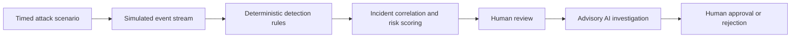

# SentinelH20

AI-assisted security monitoring for operational technology.

SentinelH20 v1 is a simulation-only OT security platform centered on a fictional facility, North River Water Utility. It combines deterministic detection, incident correlation, risk scoring, AI-assisted investigation, and human-approved simulated response actions.

## What It Demonstrates



1. A user runs one of five scripted attack scenarios.
2. The browser emits timed synthetic events and evaluates each with deterministic rules.
3. Matching detections create or update incidents for the affected asset.
4. A reviewer can request an advisory AI investigation for an incident.
5. The reviewer approves or rejects the resulting simulated response recommendations.

All data is held in browser memory. Refreshing the page resets the demonstration.

## Security Boundary

SentinelH20 v1 is defensive and simulation-only.

It does not scan public networks, exploit vulnerabilities, brute-force authentication, interact with real PLCs, or issue commands to real industrial equipment.

AI recommendations are advisory only. Approval and rejection update simulated in-memory state; they do not execute a response, change a configuration, terminate a session, or contact an external system.

## Stack

- Frontend: React + TypeScript + Vite
- Simulation: browser-memory event, detection, correlation, and response state
- AI: one Netlify Function using Groq's OpenAI-compatible API (server-side key only)

## Current Detection Model

The current rules are deliberately transparent and deterministic:

- Off-hours authentication: an `authentication` event marked `unusualHour: true`
- Unapproved remote access: a `remote_access` event marked `approvedHost: false`
- Unauthorized configuration change: a `configuration_change` event marked `approvedWindow: false`
- Abnormal PLC command sequence: a `plc_command` event containing `override` or `force_apply`
- Unauthorized privilege change: a `privilege_change` event marked `approved: false`

Each rule returns severity, confidence, and evidence. Findings affecting the same asset within 15 minutes correlate into one incident. Risk is bounded to $0$–$100$ and is calculated from severity weight, detection confidence, and a static demo asset-criticality value:

$$
	ext{risk} = \operatorname{clamp}\left(\operatorname{round}(\text{severity weight} \times \text{confidence} + 2 \times \text{asset criticality}), 0, 100\right)
$$

Severity weights are critical $90$, high $70$, medium $50$, and low $30$.

## Repository Layout

- apps/web: active React frontend for the simulation demo
- apps/api: scaffolded backend workspace for future service-layer work; not part of the current simulator runtime
- apps/web/src/lib/scenarios.ts: five timed scenario definitions
- apps/web/src/lib/detectionEngine.ts: deterministic rules, correlation, and risk scoring
- apps/web/src/hooks/useSentinelDemo.ts: in-memory demo state and scenario scheduling
- apps/web/src/services/ai.ts: browser client for same-origin AI requests
- server/aiInvestigation.ts: shared server-only Groq request, prompt, and response validation
- server/rag: curated CISA, EPA, NIST, and MITRE references with deterministic retrieval and citations
- apps/web/vite.config.ts: local development `POST /api/analyze` middleware
- netlify/functions: server-side AI investigation endpoint used in deployment
- packages/shared: shared domain types
- docs: architecture and deployment notes

## Prerequisites

- Node.js 20+

## Environment Setup

1. Copy the root environment template for local AI investigation.
2. Set the same values in Netlify for deployment.

Files:
- .env.example

Required variables:
- GROQ_API_KEY

Optional variables:
- GROQ_MODEL (defaults to `openai/gpt-oss-120b`)

## Install

Use pnpm via npx (works even if pnpm is not globally installed).

```bash
npx pnpm install
```

## Development

Run the active frontend and local AI route:

```bash
npx pnpm dev
```

The current demo runtime is the Vite frontend plus the embedded `POST /api/analyze` middleware in [apps/web/vite.config.ts](apps/web/vite.config.ts). It reads `GROQ_API_KEY` and `GROQ_MODEL` from the root `.env` file only; neither value is exposed to the browser. Restart `npx pnpm dev` after changing `.env`.

The `apps/api` folder is currently a scaffold for future backend work and is not required for the running simulation. All simulated events, detections, incidents, AI results, response approvals, and reviewer names exist only in browser memory. Refreshing the page clears the demo.

## AI and Security Controls

- `GROQ_API_KEY` is read only by server-side code from the root `.env` locally or Netlify environment variables in deployment.
- The key must never use a `VITE_` prefix and must never be committed to source control.
- The browser sends only the selected incident's bounded context to `POST /api/analyze`: at most 20 detections and 50 events, with constrained strings and arrays.
- The AI provider response is validated for the required analysis structure before it is returned to the browser.
- Provider failures return a generic error rather than provider internals.
- Deterministic detections and risk scoring remain authoritative; AI is an investigation aid, not a detection or execution authority.
- AI investigations may include citations from a small, checked-in public-source corpus. Retrieved documents are untrusted reference material and cannot override system safety rules.

## Real-World Fit

SentinelH20 is a credible workflow prototype, not a production OT security platform. Its current security concepts are applicable to real operations, but it does not yet have live telemetry ingestion, durable storage, authentication, roles, audit trails, multi-user workflows, alerting, asset inventory, or integrations with security controls.

In a production-oriented design, Sentinel would ingest authorized, read-only telemetry from identity systems, VPNs, firewalls, EDR, SIEM, network sensors, historian/SCADA audit logs, and approved OT-visibility platforms. Normalized events would be persisted and evaluated by backend workers, while the UI would provide analysts with evidence, risk context, and advisory AI summaries.

For OT environments, integrations should be passive or use approved vendor APIs and logs. The platform should not scan OT networks, poll controllers aggressively, modify PLC logic, or automatically isolate operational equipment. A real response remains a human-led process coordinated with security, operations, engineering, safety, and change-control teams.

## Validation Commands

```bash
npx pnpm typecheck
npx pnpm build
npx pnpm test
```

## Current Phase Status

Implemented foundation items:
- monorepo scaffolding
- frontend demo shell with attack scenario selector and timed live event feed
- deterministic detection engine with incident correlation and risk scoring
- AI-assisted investigation through a server-side Netlify Function and local Vite middleware (advisory only)
- human approval or rejection of simulated recommended actions

The active runtime path is the web app plus the shared server AI module. The `apps/api` workspace remains a scaffold for future backend expansion and is not part of the current demo flow. The demo intentionally excludes persistence, authentication, multi-user collaboration, audit logs, real telemetry ingestion, and real-world response execution.

## Deployment Notes

See docs/DEPLOYMENT.md for Netlify deployment guidance.
