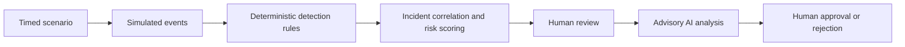
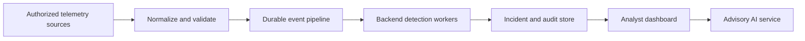

# SentinelH20 Case Study

## Building an OT Security Investigation Prototype

### The Problem

Water infrastructure increasingly combines information technology with operational technology: identity systems, remote access, engineering workstations, SCADA, HMIs, PLCs, and field sensors. That connectivity creates security visibility challenges, while incident response must also preserve availability and physical process safety.

SentinelH20 explores how an analyst could move from suspicious telemetry to explainable detections, correlated incidents, AI-assisted investigation, and human-reviewed response recommendations without allowing automation to control industrial equipment.

### The Concept

SentinelH20 is a simulation-driven OT security dashboard for a fictional water utility, North River Water Utility.

Users run one of five timed attack scenarios. The app creates simulated events, evaluates deterministic rules, correlates related findings into incidents, computes risk, and lets a reviewer request advisory AI analysis. The AI can recommend actions, but a human must approve or reject them. Those decisions remain simulated and never execute real-world actions.

### Architecture

The frontend is React, TypeScript, and Vite. Scenario state, detections, incidents, AI results, reviewer identity, and approval decisions live in browser memory. Refreshing the page resets the demonstration.

Key implementation areas:

- `apps/web/src/lib/scenarios.ts`: five timed attack scenarios.
- `apps/web/src/lib/detectionEngine.ts`: deterministic rules, correlation, and risk scoring.
- `apps/web/src/hooks/useSentinelDemo.ts`: local event scheduling and application state.
- `apps/web/src/services/ai.ts`: same-origin client for `POST /api/analyze`.
- `server/aiInvestigation.ts`: server-side Groq request handling, prompt construction, and validation.
- `apps/web/vite.config.ts`: local Vite middleware for AI requests.
- `netlify/functions/analyze.ts`: production deployment adapter.

Locally, `npx pnpm dev` serves both the dashboard and the AI route. In production, Netlify serves the static app and routes `/api/analyze` to a serverless function.

### Detection and Alerting

The prototype intentionally uses transparent rules rather than treating AI as the source of truth:

- Authentication outside an approved maintenance window
- Remote access from a non-approved host
- PLC configuration changes outside an approved window
- PLC command sequences containing override or force-apply behavior
- Unapproved privilege changes

Rules produce severity, confidence, evidence, and an affected asset. Findings for the same asset within 15 minutes correlate into one incident. Risk combines severity weight, confidence, and static asset criticality.

This makes the system explainable: an analyst can see why an alert exists before requesting AI assistance.

### Security Model

The system protects the integrity of the investigation workflow, not a real plant.

- The Groq API key is server-side only.
- The browser never receives the secret.
- The AI endpoint accepts bounded incident context and validates both input and structured output.
- Provider failures return safe generic errors.
- AI recommendations are advisory only.
- A reviewer must explicitly approve or reject simulated actions.
- The app does not scan networks, connect to PLCs, modify configurations, block traffic, or terminate sessions.

The key design decision is **deterministic detection first, AI investigation second, human approval always**.

### UX Decisions

The dashboard is designed for a short, legible investigation flow:

- One scenario runs at a time, preventing interleaved demo events.
- The event stream shows chronology and severity.
- Detection cards expose evidence and confidence.
- Incidents consolidate related findings to reduce alert fragmentation.
- The incident drawer keeps AI analysis, reviewer identity, and response decisions in one focused workspace.
- Refresh-reset state makes the demo repeatable.

The goal is operational clarity rather than a generic AI interface.

### Engineering Decisions

React and Vite keep the interface fast and simple. Browser memory removes database and deployment friction for a single-user demonstration. TypeScript provides domain models for events, detections, incidents, analyses, and response actions.

Groq is accessed through an OpenAI-compatible server-side client using `openai/gpt-oss-120b`. The same AI service module supports both local Vite development and the Netlify deployment adapter, preventing behavior drift between environments.

### Limitations

SentinelH20 is a workflow prototype, not a production SCADA or OT security platform.

It does not include live telemetry ingestion, persistent storage, authentication, RBAC, audit logging, multi-user collaboration, alert routing, authoritative asset inventory, SIEM/EDR/NDR integration, threat-intelligence enrichment, or actual response execution.

The simulated approval buttons are intentionally not connected to external controls.

### Future Architecture

A production-oriented version would ingest authorized, read-only telemetry from identity providers, VPNs, firewalls, EDR, SIEMs, network sensors, historian and SCADA audit logs, and approved OT visibility platforms.

The detection engine would move from browser memory into backend workers. Events, incidents, approvals, and audit records would persist in a database. Authentication, role-based authorization, retention, monitoring, rate limiting, and incident-management integrations would become mandatory.

For OT specifically, the system should remain passive: consume logs, mirrored traffic, or approved vendor APIs. It should not actively scan OT networks, write PLC logic, poll controllers aggressively, or automatically isolate critical equipment. Real response requires coordination among security, operations, engineering, safety, and change-control teams.

### Outcome

SentinelH20 demonstrates a credible OT incident-investigation workflow: explainable detection, risk-based prioritization, bounded AI assistance, and explicit human control. Its value is not pretending to be a production plant-security product; it is showing an understanding of what a safe, production-oriented path would require.
